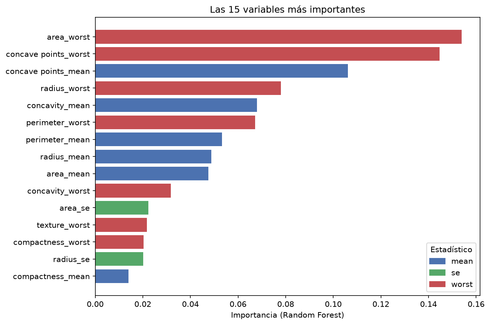
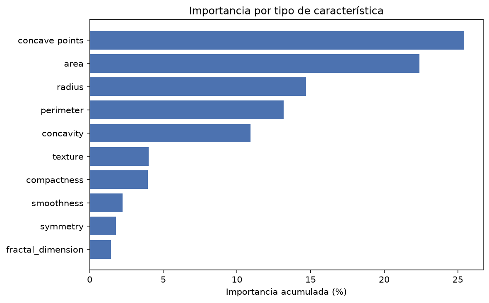
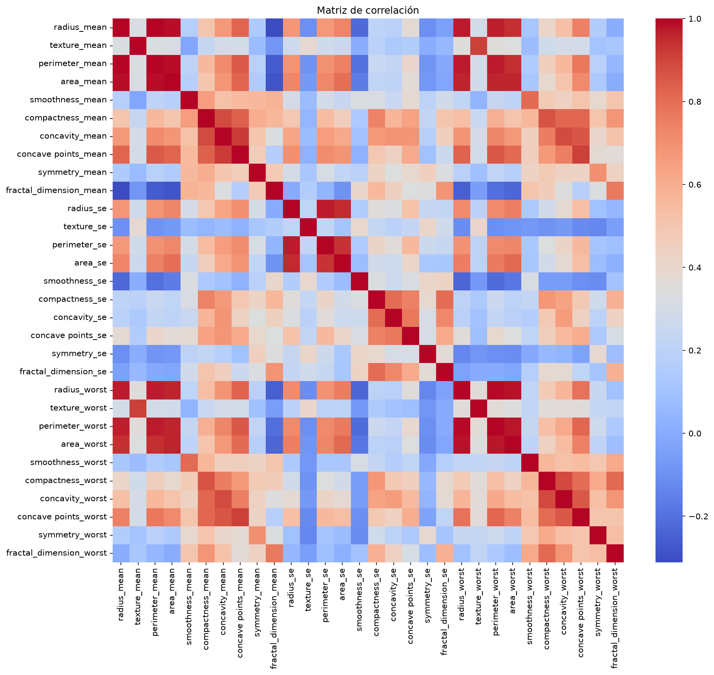

# Breast Cancer Classification

Classification of breast tumors as **benign (B)** or **malignant (M)** using the Breast Cancer Wisconsin (Diagnostic) dataset. The project compares three supervised models (Logistic Regression, Decision Tree and Random Forest) after standardization and PCA, and analyzes which variables matter most for the classification.

Clasificación de tumores de mama como **benignos (B)** o **malignos (M)** con el dataset *Breast Cancer Wisconsin (Diagnostic)*. El proyecto compara tres modelos supervisados (Regresión Logística, Árbol de Decisión y Random Forest) después de estandarizar los datos y aplicar PCA, y analiza qué variables pesan más en la clasificación. Práctica del Diplomado de Business Analytics y Data Science.

## Datos

- **Fuente:** *Breast Cancer Wisconsin (Diagnostic)*, UCI Machine Learning Repository (Wolberg, Mangasarian, Street y Street). [https://archive.ics.uci.edu/dataset/17/breast+cancer+wisconsin+diagnostic]
- **Licencia:** [Creative Commons Attribution 4.0 International (CC BY 4.0)](https://creativecommons.org/licenses/by/4.0/). Los datos se incluyen sin modificaciones; la limpieza se realiza en el notebook.
- **Contenido:** 569 registros (357 benignos, 62.7 %, y 212 malignos, 37.3 %) y 30 variables numéricas.
- **Variables:** son 10 características de los núcleos celulares, calculadas a partir de imágenes digitalizadas de un aspirado con aguja fina de la masa mamaria (`radius`, `texture`, `perimeter`, `area`, `smoothness`, `compactness`, `concavity`, `concave points`, `symmetry`, `fractal_dimension`). Cada una aparece en tres versiones: `mean` (promedio), `se` (error estándar) y `worst` (promedio de los tres valores más grandes).
- **Limpieza:** se eliminaron `id` y `Unnamed: 32` (una columna vacía que aparece por una coma sobrante en el CSV). No hay valores faltantes.

## Métodos

1. **Análisis exploratorio:** estadística descriptiva, balance de clases y matriz de correlación. Las variables de tamaño (`radius`, `perimeter`, `area`) y de irregularidad (`compactness`, `concavity`, `concave points`) están muy correlacionadas entre sí.
2. **Preprocesamiento:** partición entrenamiento/prueba 80/20 (`random_state=42`, 114 casos de prueba), estandarización con `StandardScaler` y reducción de dimensionalidad con PCA (de 30 variables a 10 componentes, 95.1 % de la varianza).
3. **Modelos:** Regresión Logística, Árbol de Decisión y Random Forest (100 árboles).
4. **Evaluación:** accuracy, matriz de confusión y reporte de clasificación (precision, recall y F1).
5. **Importancia de las variables:** se reentrenaron la Regresión Logística y el Random Forest sobre las 30 variables originales (sin PCA, porque los componentes no se pueden atribuir a una sola variable) y se combinaron cuatro medidas: importancia del Random Forest, importancia por permutación en el conjunto de prueba, coeficientes de la Regresión Logística y AUC individual de cada variable.

## Resultados

| Modelo | Accuracy | Falsos positivos | Falsos negativos |
|---|---|---|---|
| **Regresión Logística** | **98.25 %** | 1 | 1 |
| Árbol de Decisión | 94.74 % | 3 | 3 |
| Random Forest | 94.74 % | 3 | 3 |

Se eligió la **Regresión Logística** por tener la mayor accuracy y el menor número de falsos negativos, el error más delicado en un contexto médico (no detectar un tumor maligno).

### Importancia de las variables

- Las cinco variables más importantes según el Random Forest son `area_worst`, `concave points_worst`, `concave points_mean`, `radius_worst` y `concavity_mean`, que suman el 55 % de la importancia total.
- Por tipo de característica, `concave points`, `area`, `radius`, `perimeter` y `concavity` acumulan el 87 %. Textura, compacidad, suavidad, simetría y dimensión fractal suman solo el 13 %.
- Por estadístico, `worst` concentra el 54 % de la importancia, `mean` el 37 % y `se` el 9 %.
- En las 10 variables más importantes, los valores más altos corresponden a tumores malignos: es decir, tumores más grandes y con contornos más irregulares.

## Limitaciones

- La comparación de modelos se basa en **una sola partición** con 114 casos de prueba, así que la diferencia entre la Regresión Logística y los demás modelos corresponde a pocos casos.
- Los modelos principales se entrenaron sobre componentes del PCA. Entrenados sin PCA, para la sección de importancia, la Regresión Logística alcanzó 97.37 % y el Random Forest 96.49 % de accuracy en la misma partición.
- Cuando varias variables miden casi lo mismo (por ejemplo `radius`, `perimeter` y `area`, con correlaciones superiores a 0.98), la importancia se reparte entre ellas de forma algo arbitraria. Por eso conviene leerla por tipo de característica.
- La importancia describe lo que usan los modelos en este dataset. No es una relación causal y este proyecto **no está pensado para uso clínico**; es un ejercicio académico.

## Posibles mejoras

- Comparar los modelos con validación cruzada en lugar de una sola partición.
- Estratificar la partición por clase.
- Ajustar hiperparámetros y evaluar los modelos también sin PCA.

## Cómo ejecutarlo

1. Clona o descarga este repositorio.
2. Instala las dependencias: `pip install -r requirements.txt`
3. Abre `notebooks/breast_cancer_analysis.ipynb` con Jupyter Notebook y ejecuta todas las celdas en orden (**Kernel → Restart & Run All**). El notebook lee los datos desde `../data/data.csv` y guarda las gráficas en `../images/`.

## Estructura

- `data/`: archivo CSV con los datos.
- `notebooks/`: notebook con el análisis completo.
- `images/`: gráficas generadas por el notebook.
- `requirements.txt`: dependencias de Python.

## Autora

Melissa Beltrán · Universidad de Panamá
